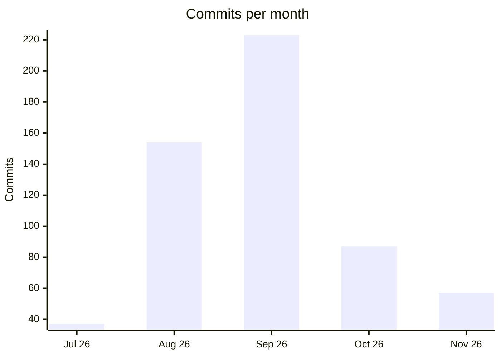
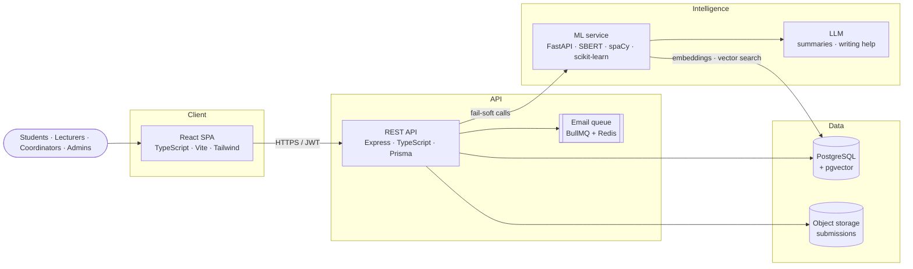

# PSEMS

### An intelligent platform for final-year engineering projects

**PSEMS uses machine learning and NLP to guide every stage of a final-year project, from shaping the idea and finding the right supervisor to evaluating the work and publishing the grade. It runs in production at the Faculty of Engineering, University of Sri Jayewardenepura.**

[**Visit the platform →**](https://psems-foe-usj.tech)

---

## The problem

Final-year projects in an engineering faculty involve hundreds of moving parts: student groups, project proposals, supervisor matching, submissions with deadlines, presentation schedules, panels of evaluators, rubrics, late penalties and grade moderation. Most of this used to run on spreadsheets, email threads and paper mark sheets, so it was slow, error-prone and hard to audit.

The hardest parts aren't administrative. They're judgement calls. Is this idea already done? Who is the right supervisor? Is the proposal complete? Which research areas is this cohort neglecting?

**PSEMS answers those questions with an AI layer built on years of real project data, and runs the rest of the lifecycle in one platform that students, supervisors, evaluators and coordinators all work in.**

## The intelligence layer

**19 AI capabilities**, built into the screens where people already work rather than kept in a separate tool.

| For | Capability | How it works |
|---|---|---|
| 🎓 **Students** | **Supervisor recommendation** | Ranks lecturers by *meaning*, not shared keywords. It compares the idea with each lecturer's research topics, past projects and teaching, and explains *why* each one matched |
| | **Live duplicate detection** | As a student types an idea, it is checked against the platform and **720 real past projects**, with tiered *similar* and *likely duplicate* warnings |
| | **Idea completeness coach** | A trained classifier checks whether a draft states its problem, approach and outcome, and coaches what's missing |
| | **Writing assistant** | LLM title suggestions and a "make this clearer" rewrite |
| | **Proposal pre-check** | A PDF proposal is checked against the faculty template before it is submitted |
| 🧑‍🏫 **Lecturers** | **Feedback polisher** | Turns rough evaluation notes into clear, constructive comments |
| 📊 **Coordinators** | **Proposal analysis** | Extracts sections, technologies and keywords, finds similar past proposals, and drafts an LLM summary with review feedback grounded in the extracted facts |
| | **Research-area intelligence** | Auto-tags every idea with its research area and keywords, then drives a live topic map, cohort trends and **topic-gap detection** |
| | **Timeline recommender** | Suggests stage dates for a new course from past courses |

**Built like a production ML system, not a demo**
- **Measured against real outcomes:** supervisor recommendation is benchmarked against real historical supervisor assignments (Precision@k, MRR), and live suggestions are logged so their real-world accuracy can be scored.
- **Trained models beat the baselines:** the completeness coach (SBERT embeddings + logistic regression) reaches **0.76 macro F1** under grouped 5-fold cross-validation, against 0.55 for keyword rules.
- **Gated model promotion:** a model registry promotes a new model only when it beats the live one on data that model has never seen.
- **Versioned outputs:** auto-tags carry a tagger version, so a model change can be re-run across stored data without overwriting what users edited by hand.
- **Evidence-led decisions:** a cross-encoder reranker was tested and **removed** because it made rankings worse at 40× the cost.
- **Fails soft:** if the ML service is offline, the platform keeps working and only the AI panels disappear.

**Pipeline:** spaCy noun-phrase extraction → Sentence-BERT embeddings → pgvector similarity search → MMR diversity → calibrated confidence bands. Research areas come from a taxonomy of **19 fields** derived from the published research of **61 real lecturers** across five engineering departments.

> **Status:** the AI layer is built, integrated into the platform and validated on real faculty data. It is being rolled out to production in stages, while the core platform is already live.

## The platform

| | |
|---|---|
| 👥 **Groups & proposals** | Students form groups (or work individually), submit project ideas and track approval |
| 🎯 **Supervisor allocation** | Preference-based matching of projects to supervisors, with coordinator overrides |
| 📅 **Scheduling** | Presentation sessions, panel assignment and live session timers |
| 📝 **Evaluation** | Configurable marking schemes and rubrics, individual and group marks, guest evaluators via secure one-time links |
| ⚖️ **Review & grading** | Coordinator review, late-submission penalties, required comments, grading scales that follow the faculty handbook |
| 🔔 **Notifications** | Queued transactional email and in-app notifications at every stage |
| 🛡️ **Administration** | Bulk account provisioning, role management, audit logging and self-service database backups |

Each course configures its own stages, marking scheme and evaluation rules, so the platform adapts to how a department already works rather than forcing one workflow on everyone.

## By the numbers

| **19** | **720** | **186** | **630+** | **<!-- commit-total:start -->558<!-- commit-total:end -->** |
|:---:|:---:|:---:|:---:|:---:|
| AI capabilities | past projects in the knowledge base | API endpoints | automated tests | commits |

## Development activity

<!-- commit-stats:start -->
| Repository | Commits | Branches | Last commit |
|---|---:|---:|---|
| `psems-frontend` | 314 | 11 | 2026-11-13 |
| `psems-backend` | 234 | 12 | 2026-11-13 |
| `psems-ml-service` | 8 | 2 | 2026-07-31 |
| `psems-infra` | 2 | 1 | 2026-07-05 |
| **Total** | **558** | | |

Since 2026-07-05 · updated automatically
<!-- commit-stats:end -->

## Architecture

A polyrepo with independently deployable services: the web client, the core API, shared infrastructure and a dedicated intelligence service. The ML service reads Postgres and pgvector directly for vector search, and keeps its own schema for embeddings, clusters and model outputs.

## Engineering highlights

**Security by design**
- Role-based access control across 8 roles, checked on every request
- Short-lived JWT access tokens, refresh tokens in HTTP-only cookies, and a forced password change on first sign-in
- Rate limiting, hardened HTTP headers, strict CORS and schema validation of every input with Zod
- An audit log of privileged actions, and private object storage for submissions

**Reliability**
- Every change goes through CI: type-checking, linting, database migrations and the full test suite against real Postgres and Redis
- Versioned, forward-only schema migrations applied automatically before each deploy
- Nightly automated database backups with tiered retention, on-demand backups from the admin console, and a tested restore procedure
- Email is sent through a background job queue with retries, so a slow mail provider never blocks a request

**Delivery**
- Continuous deployment: merging to `main` ships to production
- Environment configuration is validated at startup, so a misconfigured deploy fails at once with a clear error instead of failing silently later
- Health endpoints for monitoring each deployment

## Tech stack

| Layer | Technologies |
|---|---|
| **Frontend** | React 18, TypeScript, Vite, Tailwind CSS, TanStack Query, Zustand, React Hook Form, Zod, Vitest |
| **Backend** | Node.js, Express, TypeScript, Prisma ORM, BullMQ, Zod, Jest, Supertest |
| **Data** | PostgreSQL, pgvector, Redis, object storage |
| **AI / ML** | Python, FastAPI, Sentence-BERT, spaCy, scikit-learn, pgvector, local LLM (Llama 3.2 via Ollama) |
| **DevOps** | GitHub Actions (CI/CD and scheduled backups), Docker Compose, Vercel, Render, Supabase |

## Repositories

| Repository | Description |
|---|---|
| `psems-frontend` | Web client: role-based dashboards for every user type |
| `psems-backend` | Core REST API, business rules, CI and backup workflows |
| `psems-ml-service` | Intelligence layer: recommendation, similarity search, NLP, trained classifiers, LLM features |
| `psems-infra` | Containerised local development environment |

> The source code is private because the system handles real student records. Code walkthroughs and technical demos are available on request.

---

Built at the **Faculty of Engineering, University of Sri Jayewardenepura** 🇱🇰

**Designed and built by [Dulina Nimsara](https://github.com/DulinaS)**

